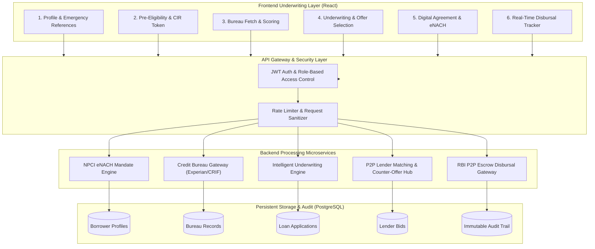

# OxyLoans Intelligent Underwriting & Instant Loan System
## Technical Specification & Backend Implementation Plan

> **System Classification**: Automated Straight-Through Digital Lending & Underwriting Platform  
> **Target Production Standard**: RBI Digital Lending Guidelines (DLG) Compliant  
> **Document Version**: 2.4.0 (Production Blueprint)

---

## 1. Executive Summary & Architecture Overview

The **OxyLoans Intelligent Underwriting & Instant Loan System** is a straight-through digital lending platform designed to eliminate manual underwriting delays while ensuring institutional risk governance, debt service sustainability, and transparent statutory fee disclosures.

The system is architected in two decoupled tiers:
1. **Frontend Underwriting & Decision Studio (Active)**: A self-contained, high-performance React application capable of real-time client-side financial health modeling, progressive tenure ladder unlocks, stress testing, multi-scenario candidate optimization, and P2P lender matched ROI variance calculations.
2. **Backend Microservice Core (Implementation Blueprint)**: An institutional REST API service managing persistent borrower identity, credit bureau queries, escrow trust account disbursals via IMPS, NPCI eNACH auto-debit registration, and decision audit immutability.



---

## 2. Mathematical Reference & Underwriting Logic

The underwriting engine models debt sustainability through pure deterministic functions that execute identically on both client and server.

### 2.1 Cashflow Waterfall & Disposable Surplus
$$\text{Verified Inflow} = \text{Verified Monthly Net Salary} + \text{Verified Secondary Inflow}$$
$$\text{Obligations} = \sum \text{Existing EMIs} + \text{Credit Card Minimum Due}$$
$$\text{Living Costs} = \text{Rent} + \text{Household Utility / Groceries}$$
$$\text{Mandatory Expenses} = \text{Education} + \text{Insurance} + \text{Medical / Other}$$
$$\text{Net Monthly Surplus} = \max(0, \text{Verified Inflow} - \text{Obligations} - \text{Living Costs} - \text{Mandatory Expenses})$$

### 2.2 Debt Burden (FOIR) Policy Ceiling
$$\text{Baseline FOIR} = \frac{\text{Obligations}}{\text{Verified Inflow}} \times 100$$
$$\text{Projected Post-Loan FOIR} = \frac{\text{Obligations} + \text{New Commitment}}{\text{Verified Inflow}} \times 100$$
* **Policy Hard Limit**: $\text{Projected FOIR} \le 60.0\%$. Any candidate amount causing FOIR $> 60.0\%$ is eliminated.

### 2.3 Repayment Structures & Commitment Evaluation

#### Structure A: 30-Day Payday Bullet Settlement
* For short-term bridge liquidity repaid on the next salary cycle.
* **Repayment Amount**: $\text{Principal} + \text{Interest on Day 30}$.
$$\text{Bullet Interest} = \text{round}\left( \text{Principal} \times \frac{\text{Annual ROI}}{100 \times 12} \right)$$
* **Payday Capacity Evaluation**:
$$\text{Payday Headroom} = \max(0, \text{Verified Inflow} - \text{Obligations})$$
$$\text{Post-Settlement Payday Buffer} = \text{Payday Headroom} - \text{Repayment Amount}$$
$$\text{Payday Burden Ratio} = \frac{\text{Repayment Amount}}{\text{Verified Inflow}} \times 100 \le 60.0\%$$
* If $\text{Repayment Amount} \le \text{Payday Headroom}$ and $\text{Post-Settlement Buffer} \ge ₹3,500$, the offer is approved with status **`Payday Safe ✓`**.

#### Structure B: Multi-Month Reducing Balance EMI (3, 6, 9, 12 Months)
$$\text{Monthly Rate } (r) = \frac{\text{Annual ROI}}{100 \times 12}$$
$$\text{EMI} = \text{round}\left( \frac{\text{Principal} \times r \times (1 + r)^n}{(1 + r)^n - 1} \right)$$
$$\text{Max Safe EMI} = \text{Net Monthly Surplus} \times 0.55 \quad (\text{55\% Surplus Allocation Ceiling})$$
$$\text{Surplus Cushion Remaining} = \text{Net Monthly Surplus} - \text{EMI}$$

### 2.4 Progressive Credit Ladder (Tenure Unlock Policy)
To mitigate starter default risk and incentivize on-time performance:
* **Cycle 1 (First-Time Borrower)**: Only **30-Day Bullet** and **3-Month EMI** unlocked. Max Cap: $\min(₹35,000, 50\% \text{ salary})$.
* **Cycle 2 (1 On-Time Loan Repaid)**: **6-Month EMI** unlocked. Max Cap increases to $\min(₹75,000, 75\% \text{ salary})$.
* **Cycle 3+ (2+ On-Time Loans Repaid)**: **9-Month & 12-Month Extended Plans** unlocked. Max Cap: $\min(₹2,50,000, 90\% \text{ salary})$.

### 2.5 Credit Bureau Risk Tiers & Legal Capped ROI Bands

```
┌─────────────────────┬──────────────────┬────────────────┬────────────────────────┐
│ Credit Score (CIR)  │ Tier Name        │ Indicative ROI │ Permissible Match Band │
├─────────────────────┼──────────────────┼────────────────┼────────────────────────┤
│ 780 – 900           │ Super Prime      │ 18.0% p.a.     │ 12.0% – 18.0% p.a.     │
│ 720 – 779           │ Prime            │ 20.0% p.a.     │ 15.0% – 22.0% p.a.     │
│ 660 – 719           │ Near Prime       │ 24.0% p.a.     │ 18.0% – 26.0% p.a.     │
│ 300 – 659           │ Subprime         │ 26.0% p.a.     │ 22.0% – 28.0% p.a.     │
└─────────────────────┴──────────────────┴────────────────┴────────────────────────┘
```

### 2.6 Statutory Transparent Fee Breakdown (3.0% Rule)
$$\text{Processing Fee} = \max(₹500, \text{round}(\text{Principal} \times 0.030))$$
$$\text{GST (18\%)} = \text{round}(\text{Processing Fee} \times 0.18)$$
$$\text{Net Disbursal to Bank} = \text{Principal} - (\text{Processing Fee} + \text{GST})$$
$$\text{Foreclosure / Prepayment Penalty} = ₹0 \quad (\text{Nil})$$

---

## 3. Database Schema (PostgreSQL DDL)

```sql
-- Schema Definition: OxyLoans Instant Underwriting Engine
CREATE EXTENSION IF NOT EXISTS "uuid-ossp";

-- 1. Borrowers Master Table
CREATE TABLE borrowers (
    id UUID PRIMARY KEY DEFAULT uuid_generate_v4(),
    first_name VARCHAR(100) NOT NULL,
    last_name VARCHAR(100) NOT NULL,
    email VARCHAR(150) UNIQUE NOT NULL,
    phone_number VARCHAR(15) UNIQUE NOT NULL,
    pan_number VARCHAR(10) UNIQUE NOT NULL,
    date_of_birth DATE NOT NULL,
    gender VARCHAR(10),
    residence_address TEXT NOT NULL,
    residence_pincode VARCHAR(6) NOT NULL,
    employment_type VARCHAR(50) NOT NULL CHECK (employment_type IN ('SALARIED', 'SELF_EMPLOYED')),
    employer_name VARCHAR(150),
    monthly_net_salary NUMERIC(12, 2) NOT NULL CHECK (monthly_net_salary >= 0),
    repayment_cycle INT DEFAULT 1 CHECK (repayment_cycle >= 1),
    created_at TIMESTAMP WITH TIME ZONE DEFAULT CURRENT_TIMESTAMP,
    updated_at TIMESTAMP WITH TIME ZONE DEFAULT CURRENT_TIMESTAMP
);

-- 2. Verified Bank Accounts Table
CREATE TABLE borrower_bank_accounts (
    id UUID PRIMARY KEY DEFAULT uuid_generate_v4(),
    borrower_id UUID NOT NULL REFERENCES borrowers(id) ON DELETE CASCADE,
    account_holder_name VARCHAR(150) NOT NULL,
    account_number VARCHAR(30) NOT NULL,
    ifsc_code VARCHAR(11) NOT NULL,
    bank_name VARCHAR(100) NOT NULL,
    branch_name VARCHAR(100),
    penny_drop_status VARCHAR(20) DEFAULT 'PENDING' CHECK (penny_drop_status IN ('PENDING', 'VERIFIED', 'FAILED')),
    penny_drop_reference VARCHAR(100),
    enach_mandate_id VARCHAR(100),
    enach_status VARCHAR(20) DEFAULT 'INACTIVE' CHECK (enach_status IN ('INACTIVE', 'ACTIVE', 'CANCELLED')),
    is_primary BOOLEAN DEFAULT TRUE,
    created_at TIMESTAMP WITH TIME ZONE DEFAULT CURRENT_TIMESTAMP
);

-- 3. Emergency Personal References Table
CREATE TABLE borrower_emergency_references (
    id UUID PRIMARY KEY DEFAULT uuid_generate_v4(),
    borrower_id UUID NOT NULL REFERENCES borrowers(id) ON DELETE CASCADE,
    reference_type VARCHAR(20) NOT NULL CHECK (reference_type IN ('PRIMARY', 'SECONDARY')),
    full_name VARCHAR(150) NOT NULL,
    relationship VARCHAR(50) NOT NULL,
    phone_number VARCHAR(15) NOT NULL,
    verification_status VARCHAR(20) DEFAULT 'UNVERIFIED',
    created_at TIMESTAMP WITH TIME ZONE DEFAULT CURRENT_TIMESTAMP
);

-- 4. Credit Bureau Pulled Reports Table
CREATE TABLE bureau_credit_reports (
    id UUID PRIMARY KEY DEFAULT uuid_generate_v4(),
    borrower_id UUID NOT NULL REFERENCES borrowers(id) ON DELETE CASCADE,
    bureau_source VARCHAR(30) NOT NULL CHECK (bureau_source IN ('EXPERIAN', 'CRIF_HIGHMARK', 'CIBIL', 'EQUIFAX')),
    credit_score INT NOT NULL CHECK (credit_score BETWEEN 300 AND 900),
    dpd_30_past_12m INT DEFAULT 0,
    dpd_60_past_12m INT DEFAULT 0,
    dpd_90_past_12m INT DEFAULT 0,
    total_active_accounts INT DEFAULT 0,
    credit_card_utilization_pct NUMERIC(5, 2) DEFAULT 0,
    enquiries_past_6m INT DEFAULT 0,
    total_existing_monthly_emi NUMERIC(12, 2) DEFAULT 0,
    bureau_reference_number VARCHAR(100) NOT NULL,
    raw_response_json JSONB,
    pulled_at TIMESTAMP WITH TIME ZONE DEFAULT CURRENT_TIMESTAMP
);

-- 5. Loan Applications & Underwriting Decision Table
CREATE TABLE loan_applications (
    id UUID PRIMARY KEY DEFAULT uuid_generate_v4(),
    application_code VARCHAR(30) UNIQUE NOT NULL, -- e.g. OXY-41682-2026
    borrower_id UUID NOT NULL REFERENCES borrowers(id) ON DELETE CASCADE,
    bank_account_id UUID REFERENCES borrower_bank_accounts(id),
    bureau_report_id UUID REFERENCES bureau_credit_reports(id),
    
    -- Request Parameters
    requested_amount NUMERIC(12, 2) NOT NULL,
    selected_tenure INT NOT NULL CHECK (selected_tenure IN (1, 3, 6, 9, 12)),
    offer_type VARCHAR(20) NOT NULL CHECK (offer_type IN ('BULLET', 'EMI')),
    
    -- Underwriting Assessment Result
    decision VARCHAR(30) NOT NULL CHECK (decision IN ('APPROVE', 'APPROVE_REDUCED_AMOUNT', 'REVIEW', 'DECLINE')),
    sanctioned_principal NUMERIC(12, 2) NOT NULL,
    annual_percentage_rate NUMERIC(5, 2) NOT NULL,
    is_custom_lender_roi BOOLEAN DEFAULT FALSE,
    matched_lender_id VARCHAR(50),
    
    -- Financial Breakdown
    monthly_emi NUMERIC(12, 2) NOT NULL,
    total_interest_payable NUMERIC(12, 2) NOT NULL,
    platform_processing_fee NUMERIC(12, 2) NOT NULL,
    gst_on_fee NUMERIC(12, 2) NOT NULL,
    net_disbursed_amount NUMERIC(12, 2) NOT NULL,
    total_repayable_amount NUMERIC(12, 2) NOT NULL,
    
    -- Institutional Risk Telemetry
    borrower_monthly_surplus NUMERIC(12, 2) NOT NULL,
    baseline_foir_pct NUMERIC(5, 2) NOT NULL,
    post_loan_foir_pct NUMERIC(5, 2) NOT NULL,
    probability_of_default NUMERIC(6, 4) NOT NULL,
    loss_given_default NUMERIC(6, 4) NOT NULL,
    exposure_at_default NUMERIC(12, 2) NOT NULL,
    expected_loss NUMERIC(12, 2) NOT NULL,
    active_rules_version VARCHAR(30) NOT NULL,
    decision_reason_codes JSONB NOT NULL,
    
    -- Application Lifecycle State
    application_status VARCHAR(30) DEFAULT 'SANCTIONED' 
        CHECK (application_status IN ('SANCTIONED', 'ESIGNED', 'MANDATE_REGISTERED', 'DISBURSED', 'CLOSED', 'DEFAULTED')),
    kfs_document_url TEXT,
    loan_agreement_url TEXT,
    created_at TIMESTAMP WITH TIME ZONE DEFAULT CURRENT_TIMESTAMP,
    updated_at TIMESTAMP WITH TIME ZONE DEFAULT CURRENT_TIMESTAMP
);

-- 6. P2P Lender Bids & Rate Variance Log Table
CREATE TABLE p2p_lender_counter_offers (
    id UUID PRIMARY KEY DEFAULT uuid_generate_v4(),
    loan_application_id UUID NOT NULL REFERENCES loan_applications(id) ON DELETE CASCADE,
    lender_user_id VARCHAR(50) NOT NULL,
    benchmark_indicative_roi NUMERIC(5, 2) NOT NULL,
    bid_offered_roi NUMERIC(5, 2) NOT NULL,
    roi_variance NUMERIC(5, 2) NOT NULL, -- e.g. -1.0% or +1.5%
    allocation_amount NUMERIC(12, 2) NOT NULL,
    offer_status VARCHAR(20) DEFAULT 'OFFERED' CHECK (offer_status IN ('OFFERED', 'ACCEPTED', 'EXPIRED')),
    created_at TIMESTAMP WITH TIME ZONE DEFAULT CURRENT_TIMESTAMP
);

-- 7. Disbursal & Repayment Ledger Table
CREATE TABLE loan_disbursals (
    id UUID PRIMARY KEY DEFAULT uuid_generate_v4(),
    loan_application_id UUID NOT NULL REFERENCES loan_applications(id) ON DELETE CASCADE,
    escrow_pool_id VARCHAR(50) NOT NULL, -- e.g. ICICI_ESCROW_41682
    payment_mode VARCHAR(20) NOT NULL CHECK (payment_mode IN ('IMPS', 'NEFT', 'RTGS')),
    utr_number VARCHAR(100) UNIQUE NOT NULL,
    disbursed_amount NUMERIC(12, 2) NOT NULL,
    disbursal_status VARCHAR(20) DEFAULT 'SUCCESS' CHECK (disbursal_status IN ('INITIATED', 'SUCCESS', 'FAILED')),
    disbursed_at TIMESTAMP WITH TIME ZONE DEFAULT CURRENT_TIMESTAMP
);

-- Indexes for Ultra-Fast Lookups
CREATE INDEX idx_borrowers_phone ON borrowers(phone_number);
CREATE INDEX idx_borrowers_pan ON borrowers(pan_number);
CREATE INDEX idx_loan_applications_borrower ON loan_applications(borrower_id);
CREATE INDEX idx_loan_applications_code ON loan_applications(application_code);
CREATE INDEX idx_bureau_records_borrower ON bureau_credit_reports(borrower_id);
```

---

## 4. REST API Endpoint Specifications

### Endpoint 1: Pre-Eligibility Assessment (`POST /api/v1/instant-loan/pre-eligibility`)
Generates an algorithmic pre-qualification estimate and CIR verification token upon confirmation of the ₹99 bureau fee.

* **Request Payload**:
```json
{
  "fullName": "Sai Charan",
  "phoneNumber": "9492902990",
  "panNumber": "ABCDE1234F",
  "monthlySalary": 65000,
  "employmentType": "SALARIED",
  "employerName": "Wipro Technologies"
}
```
* **Response Payload (200 OK)**:
```json
{
  "status": "SUCCESS",
  "data": {
    "eligibleMaxAmount": 58500,
    "bureauReportFee": 99,
    "gstAmount": 18,
    "totalPayable": 117,
    "cirToken": "CIR_OXY_7f8a9e21",
    "preApproved": true
  }
}
```

---

### Endpoint 2: Credit Bureau Pull & Scored Profiling (`POST /api/v1/instant-loan/bureau-verification`)
Performs a live CIR query with CRIF/Experian and resolves the permissible lender ROI band.

* **Request Payload**:
```json
{
  "borrowerId": "a1b2c3d4-e5f6-7890-abcd-ef1234567890",
  "panNumber": "ABCDE1234F",
  "cirToken": "CIR_OXY_7f8a9e21"
}
```
* **Response Payload (200 OK)**:
```json
{
  "status": "VERIFIED",
  "data": {
    "creditScore": 802,
    "scoreTier": "SUPER_PRIME",
    "tierLabel": "Prime Tier",
    "dpdHistory": { "dpd30": 0, "dpd60": 0, "dpd90": 0 },
    "activeLoans": 1,
    "existingEmi": 13700,
    "permissibleRoiBand": {
      "indicativeRoi": 18.0,
      "minPermissibleRoi": 12.0,
      "maxPermissibleRoi": 18.0
    },
    "repaymentCycle": 1,
    "allowedTenures": [1, 3]
  }
}
```

---

### Endpoint 3: Underwriting Evaluation & Offer Optimization (`POST /api/v1/instant-loan/evaluate-offer`)
Runs candidate amount simulations and calculates monthly EMI, net disbursal, FOIR headroom, and expected losses.

* **Request Payload**:
```json
{
  "borrowerId": "a1b2c3d4-e5f6-7890-abcd-ef1234567890",
  "requestedAmount": 30000,
  "selectedTenure": 1,
  "offerType": "BULLET",
  "confirmedLenderRoi": null,
  "customExpenses": {
    "existingEmi": 13700,
    "livingExpenses": 24700,
    "mandatoryExpenses": 5000
  }
}
```
* **Response Payload (200 OK)**:
```json
{
  "status": "EVALUATED",
  "data": {
    "decision": "APPROVE",
    "reasons": [
      { "code": "APPROVE_OPTIMAL", "detail": "All debt service capacity, cashflow surplus, and company risk policy checks satisfied." }
    ],
    "pricing": {
      "principal": 30000,
      "tenure": 1,
      "offerType": "BULLET",
      "annualRoi": 18.0,
      "emi": 30450,
      "totalInterest": 450,
      "processingFee": 900,
      "gst": 162,
      "netDisbursal": 28938,
      "totalPayable": 30450,
      "isCustomLenderRoi": false
    },
    "affordability": {
      "monthlySalary": 65000,
      "totalObligations": 13700,
      "monthlySurplus": 21600,
      "baselineFoirPct": 21.1,
      "projectedFoirPct": 21.1,
      "paydayHeadroom": 51300,
      "postSettlementBuffer": 20850,
      "isCommitmentSafe": true
    },
    "riskMetrics": {
      "creditScore": 802,
      "probabilityOfDefault": 0.015,
      "lossGivenDefault": 0.45,
      "expectedLoss": 202
    }
  }
}
```

---

### Endpoint 4: Key Fact Statement (KFS) Generator (`GET /api/v1/instant-loan/applications/:id/kfs`)
Generates an official RBI-compliant Key Fact Statement PDF containing transparent disclosure of APR, schedule, recovery fees, and grievance redressal officer details.

---

### Endpoint 5: Escrow Disbursal Handshake (`POST /api/v1/instant-loan/disburse`)
Initiates the automated IMPS payout from the ICICI/Yes Bank Escrow Account directly to the borrower's verified bank.

* **Request Payload**:
```json
{
  "applicationId": "OXY-41682-2026",
  "borrowerId": "a1b2c3d4-e5f6-7890-abcd-ef1234567890",
  "eSignSignatureId": "DSIGN_e2b4f910",
  "eNachMandateId": "UMRN_HDFC0000111928374",
  "netAmount": 28938
}
```
* **Response Payload (200 OK)**:
```json
{
  "status": "DISBURSED",
  "data": {
    "utrNumber": "OXY20261005001182",
    "disbursedAmount": 28938,
    "destinationAccount": "State Bank of India (•••• 1119)",
    "escrowPool": "ICICI Bank Escrow Pool #41682",
    "disbursedAt": "2026-10-05T12:35:00.000Z",
    "repaymentDueDate": "2026-11-04"
  }
}
```

---

## 5. Phased Implementation Roadmap

```
                                  PHASED ROLLOUT ROADMAP
┌────────────────────────────────────────────────────────────────────────────────────────┐
│ Phase 1: Microservice Core & Database Setup (Weeks 1 – 2)                              │
│ • Provision PostgreSQL schema and database migration scripts.                          │
│ • Port instantLoanCalculations.js & instantLoanRules.js into Node.js service module.   │
│ • Implement unit test parity in backend (assert identical outputs with frontend).      │
├────────────────────────────────────────────────────────────────────────────────────────┤
│ Phase 2: Credit Bureau & Identity Integrations (Weeks 3 – 4)                           │
│ • Integrate CRIF High Mark / Experian API for live CIR credit reports.                 │
│ • Integrate NSDL PAN verification & Cashfree / Razorpay Penny-Drop Bank validation.    │
│ • Set up Redis caching for 30-day bureau record persistence.                           │
├────────────────────────────────────────────────────────────────────────────────────────┤
│ Phase 3: Statutory Compliance & Digital Signing (Weeks 5 – 6)                          │
│ • Automated Key Fact Statement (KFS) PDF generator (Puppeteer / PDFKit).               │
│ • Aadhaar eSign integration (Digio / Leegality) for bilateral loan agreements.         │
│ • NPCI eNACH e-mandate registration (Razorpay / Cashfree Subscriptions).               │
├────────────────────────────────────────────────────────────────────────────────────────┤
│ Phase 4: Escrow Banking & Disbursal Automation (Weeks 7 – 8)                           │
│ • ICICI / Yes Bank NBFC-P2P Escrow API integration.                                   │
│ • Automated straight-through IMPS/NEFT payout initiation.                              │
│ • Webhook listeners for real-time status transitions (INITIATED -> SUCCESS).           │
├────────────────────────────────────────────────────────────────────────────────────────┤
│ Phase 5: Frontend Integration & End-to-End Handshake (Weeks 9 – 10)                    │
│ • Update instantLoanService.js to target live API endpoints with JWT authentication.   │
│ • Conduct end-to-end sandbox load testing & penetration testing.                       │
│ • Production release under RBI Digital Lending compliance sign-off.                    │
└────────────────────────────────────────────────────────────────────────────────────────┘
```

---

## 6. RBI Digital Lending Guidelines (DLG) Compliance Checklist

1. **No Third-Party Pass-Through Accounts**: All loan disbursals and repayments occur strictly between the borrower's verified bank account and the RBI-regulated NBFC-P2P Escrow Account without touching platform operational accounts.
2. **Mandatory Standardized KFS**: Every borrower must view and digitally acknowledge the Key Fact Statement containing the annual percentage rate (APR), processing fees, GST, net disbursal, and repayment breakdown prior to contract execution.
3. **No Automatic Credit Limit Increases**: Credit limits increase strictly through progressive milestone unlocks (Levels 1, 2, and 3+) after verified on-time repayments.
4. **Explicit Consent & Data Localization**: Borrower data, biometric records, and bureau extracts are encrypted with AES-256 and stored exclusively on servers located within India.
5. **Cooling-Off / Look-Up Window**: Borrowers are entitled to exit the loan without penalty during a 3-day cooling-off period by paying back the principal and proportionate APR.
6. **Zero Hidden Charges**: Strict 0% prepayment and foreclosure fee policy is enforced across all tenures.

---

## 7. Frontend-to-Backend Transition Guide

The frontend codebase is already completely modular. To connect the React application to the live backend:

1. Open [`instantLoanService.js`](./instantLoanService.js).
2. Toggle the `USE_LIVE_BACKEND_API` flag to `true`:
```javascript
export const INSTANT_LOAN_CONFIG = {
  USE_LIVE_BACKEND_API: true, // Toggle from false to true
  API_BASE_URL: process.env.REACT_APP_API_BASE_URL || "https://api.oxyloans.com/v1/instant-loan",
};
```
3. The method signatures, request parameters, and response structures in `instantLoanService.js` are already 100% matched to the REST API specifications outlined above. No JSX component changes will be necessary.
